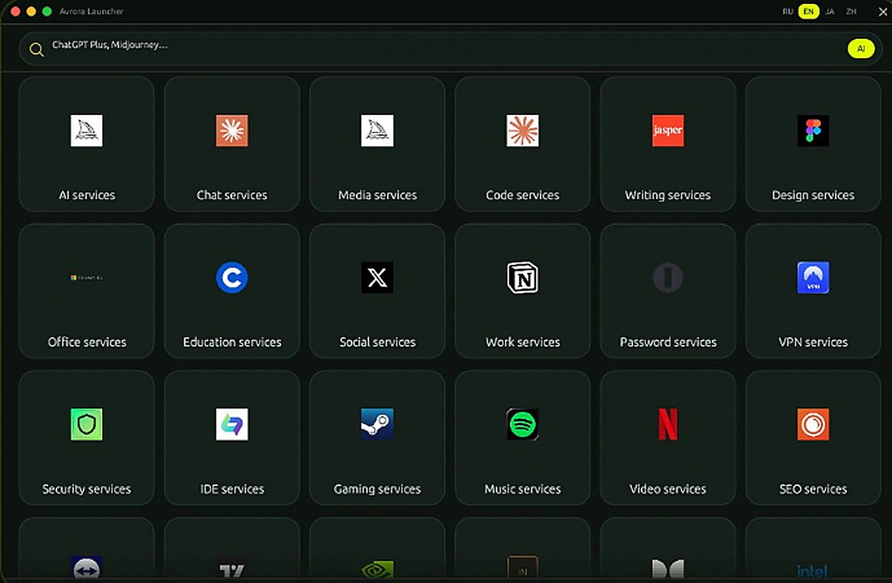

# Storytel Unlimited Free 2026 — unlimited audiobooks, ebooks, offline

> **Storytel is paid everywhere. In our Aivora launcher the same paid Unlimited version is free.**
>
> Official site / app store = paid Unlimited subscription. Aivora launcher = that paid Unlimited product, free on Windows 10 / 11.

**Keywords:** Storytel Unlimited · Storytel free · Storytel windows · audiobooks · ebooks · paid Storytel free through launcher · Aivora Programs

Windows 10 / 11 · Storytel Unlimited · Music streaming

The orange button opens [https://aivoraprograms.com/](https://aivoraprograms.com/). Install Aivora, then **Activate** **Storytel**. You get the **paid Unlimited** product **for free in our launcher**. No `Storytel.exe` in this repository.

## What Storytel is

Storytel Unlimited is the paid library SKU: **unlimited audiobooks**, **ebooks in the plan**, offline, kids mode, family, Originals. The Aivora card is **Unlimited**, not a one-title checkout. This is not Audible Premium Plus and not Amazon Music.

**Storytel is paid everywhere else.** Official access is a Unlimited subscription. In **our Aivora launcher** that same paid Unlimited is **free** on Windows 10 / 11. No vendor account. No credit card.

## unlimited audiobooks, ebooks, offline

Unlimited is the listen-all extra versus Audible’s monthly credit. Kids mode is the family extra. After **Activate**, open Storytel from streaming. This repo has no .mp3 dump.

## Who this Windows page is for

Searches **Storytel**, **Storytel windows**, **Storytel free** wanting **paid Unlimited**.

## What the Unlimited card includes

| Feature | Official Storytel | In our Aivora launcher |
|---------|--------------|------------------------|
| Price | Paid Unlimited subscription | **Free** (same paid Unlimited) |
| **Unlimited audiobooks** | Unlimited | Same paid Unlimited, free here |
| **Ebooks in the plan** | Unlimited | Same paid Unlimited, free here |
| **Offline + kids mode** | Unlimited | Same paid Unlimited, free here |

## How to open paid Storytel on Windows

1. Open [https://aivoraprograms.com/](https://aivoraprograms.com/)
2. Download **Aivora Launcher**
3. Install on **Windows 10** or **Windows 11** (64-bit)
4. Open **Music streaming**
5. Find **Storytel** and press **Activate**

Paid Storytel Unlimited — **free in our launcher**, paid on the official site.

## Search queries this page covers

- **Storytel Unlimited**
- **Storytel free**
- **Storytel windows**
- **audiobooks**
- **paid Storytel free through launcher**

## Screenshots

Aivora launcher hub — **Music streaming** → **Storytel**:

## FAQ

**Is this Audible?**  
No. Audible Premium Plus is a different Aivora card. This tile is Storytel Unlimited.

**Where is the download?**  
[https://aivoraprograms.com/](https://aivoraprograms.com/)

**Is Storytel paid or free?**  
Paid everywhere (official Unlimited). **Free in our Aivora launcher** — same paid Unlimited version.

**Do I need a Storytel account?**  
No. **Activate** on the tile.

---

## На русском

# Storytel Unlimited бесплатно 2026 — безлимит аудиокниг, ebook, офлайн

> **Везде Storytel платный. В нашем лаунчере Aivora та же платная версия Unlimited — бесплатно.**
>
> Официальный сайт / магазин = платная подписка Unlimited. Лаунчер Aivora = этот же платный Unlimited, бесплатно на Windows 10 / 11.

**Ключевые слова:** Storytel Unlimited · Storytel бесплатно · Storytel windows · аудиокниги · ebook · платный Storytel бесплатно через лаунчер · Aivora Programs

Оранжевая кнопка — главная Aivora. Лаунчер → **Стриминг музыка** → **Storytel** → **Активировать**. Это **платный Unlimited**, у нас в лаунчере **бесплатно**.

Storytel Unlimited — платная библиотека: **безлимит аудиокниг**, **ebook в плане**, офлайн, детский режим, семья, Originals. Карточка Aivora — **Unlimited**, не одна книга. Это не Audible и не Amazon Music.

**Storytel везде платный.** Официально подписка Unlimited. **В нашем лаунчере Aivora** та же платная Unlimited-версия — **бесплатно** на Windows 10 / 11.

Unlimited — слушать всё, не кредит Audible. Детский режим — семья. Файлов .mp3 в git нет.

Запросы **Storytel**, **Storytel бесплатно** — нужен **платный Unlimited**.

| Функция | Официально | В нашем лаунчере Aivora |
|---------|------------|-------------------------|
| Цена | Платная подписка Unlimited | **Бесплатно** (тот же Unlimited) |
| **Безлимит аудиокниг** | Unlimited | Та же платная Unlimited, у нас бесплатно |
| **Ebook в плане** | Unlimited | Та же платная Unlimited, у нас бесплатно |
| **Офлайн и детский режим** | Unlimited | Та же платная Unlimited, у нас бесплатно |

Как открыть: [https://aivoraprograms.com/](https://aivoraprograms.com/) → лаунчер → **Стриминг музыка** → **Storytel** → **Активировать**.

**Это Audible?**  
Нет. Audible — другая карточка. Здесь Storytel Unlimited.

Storytel — товарный знак Storytel AB. Страница описывает доступ через Aivora Programs.

[https://aivoraprograms.com](https://aivoraprograms.com/) · hello@aivora.app

#windows11 #windows10 #storytel #audiobooks #aivora

---

*Storytel Unlimited · Storytel free · Storytel windows · audiobooks · ebooks · paid Storytel free through launcher · Aivora Programs · paid Storytel free through launcher · Aivora Programs · https://aivoraprograms.com/programs/storytel/*
